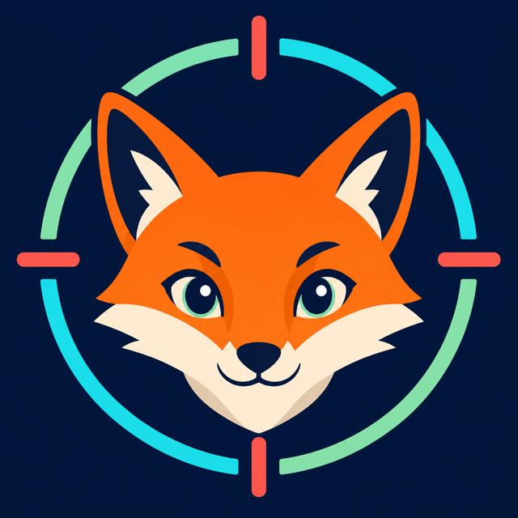

+++
title = "Apps von Melfware"
description = "Fokusfuchs und M-Note: native Apps für Konzentration und Notizen, mit Funktionen, Verfügbarkeit und Entwicklungsstand."
template = "prose.html"
[extra]
lang = "de"
subtitle = "Fokusfuchs und M-Note: Funktionen, Verfügbarkeit und Entwicklungsstand."
+++

Zwei Apps, zwei unterschiedliche Aufgaben: Fokusfuchs hilft beim regelmässigen Üben. M-Note gibt Gedanken und Aufzeichnungen einen Platz in eigenen Dateien.

## Fokusfuchs

**Kostenlos im App Store, für iPhone und iPad ab iOS 26.**

Comics zeichnen, Handschrift üben, Schulübungen und Konzentrationstraining. Lokale Profile, Tagesziel, XP und Abzeichen machen den eigenen Fortschritt sichtbar. Die App benötigt kein Konto und enthält weder Werbung noch Analyse-Tracking.

Im App Store ist Version 2.3 erhältlich. Sie bringt die Zahlenreise: Zahlwörter auf Französisch, Italienisch oder Englisch hören und im Quiz zuordnen. Unter «Heute» sind die Übungen schneller zu finden. Dazu gehören die Comic-Werkstatt aus Version 2.2 und das Handschrifttraining mit Apple Pencil aus Version 2.0.

Version 2.4 ist in der internen Testphase. Sie bringt unter anderem «Fuchs spricht»: Anleitungen, Rückmeldungen und Lesetexte können vorgelesen werden. Wann 2.4 im App Store erscheint, steht noch nicht fest.

[App kennenlernen](/fokusfuchs-ios/) · [Im App Store](https://apps.apple.com/ch/app/fokusfuchs/id6799122095) · [Comic-Werkstatt](/blog/fokusfuchs-2-2-comic-werkstatt/)

## M-Note

**In einer internen TestFlight-Beta, für iPhone und iPad ab iOS 27.**

Markdown-Dateien in iCloud Drive, Ordner, Volltextsuche mit Fundstelle in der Vorschau und eine getrennte Leseansicht. Dazu kommen Anhänge und Sprachnotizen mit optionaler AI-Verarbeitung. Eine Watch-App und eine Teilen-Erweiterung gehören zum Entwicklungsstand.

Der aktuelle Stand ist Version 0.52.2 (Build 99) vom 21. November 2026. Neu sind unter anderem eine Einschätzung der Aufnahmequalität, ein klarerer Einstieg und das Erscheinungsbild «Graphit». M-Note ist noch nicht öffentlich im App Store verfügbar.

[App und Entwicklungsstand](/m-note/) · [Früheren Entwicklungsbericht lesen](/blog/m-note-markdown-und-sprachnotizen/)
