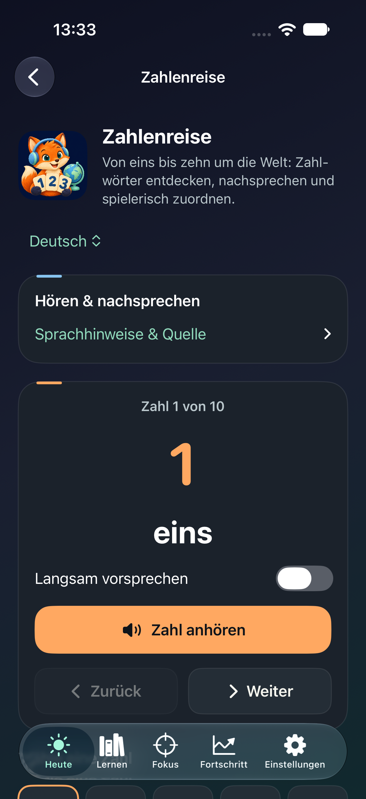

+++
title = "November-Stand: Zahlenreise, ein Fuchs, der vorliest, und eine aufgeräumte M-Note"
date = 2026-11-21T18:00:00+01:00
slug = "november-stand-fokusfuchs-m-note"
description = "Fokusfuchs 2.3 ist im App Store, Version 2.4 mit «Fuchs spricht» ist im Test. M-Note bekommt eine Suche mit Fundstelle und einen klareren Einstieg."
[taxonomies]
tags = ["Fokusfuchs", "M-Note", "App Store", "TestFlight", "iPhone", "iPad"]
[extra]
text_origin = "ai-generated"
lang = "de"
+++

Seit dem letzten Beitrag ist bei beiden Apps einiges passiert. Fokusfuchs 2.3 ist im App Store, die nächste Version ist bereits im Test. M-Note ist in der internen Beta ein gutes Stück weiter. Hier ist der Überblick.

## Fokusfuchs 2.3: Von eins bis zehn um die Welt

Mit der Zahlenreise blätterst du durch Lernkarten und ordnest Zahlwörter im Quiz zu. Deutsch, Englisch, Französisch, Italienisch und Spanisch kannst du normal oder langsam anhören. Latein, Altgriechisch, Sumerisch, Sanskrit und ägyptische Zahlzeichen erkundest du auf Text- und Zeichenkarten.

Auf «Heute» steht der Tagesfokus jetzt direkt unter der Begrüssung. «Neu entdecken» führt mit einem kurzen Tipp zur Zahlenreise oder zur Comic-Werkstatt.

Version 2.3 ist kostenlos im [App Store](https://apps.apple.com/ch/app/fokusfuchs/id6799122095) erhältlich, für iPhone und iPad ab iOS 26.

## Ein Blick auf Fokusfuchs 2.4: Der Fuchs liest vor

Version 2.4 ist in der internen Testphase. Die wichtigste Neuerung heisst «Fuchs spricht»: Anleitungen, Rückmeldungen, Lesetexte, Uhrzeiten und Zahlwörter können vorgelesen werden. Derselbe Lautsprecher startet und stoppt das Vorlesen überall in der App. Wer es nicht braucht, schaltet es in den Einstellungen dauerhaft aus.

Zur Auswahl stehen vier eigene Fuchsstimmen: hell, sanft, Junge und Erzähler. Die Sprache entsteht direkt auf dem Gerät. Dafür gibt es einen freiwilligen Download von rund 1,7 GB über WLAN. Neue Sätze kann der Fuchs auf Geräten mit mindestens 8 GB Arbeitsspeicher sprechen. Die Texte bleiben auf dem Gerät. Nur der Download des Sprachpakets verbindet sich mit einem externen Server.

Dazu kommen kleinere Verbesserungen:

- **Klarerer Hinweis zur Stufe.** Auf «Heute» erkennst du besser, ob der Fuchs noch ein paar vergleichbare Runden braucht, ob du auf deiner Stufe bleiben kannst oder ob eine andere Stufe vorgeschlagen wird. Gewechselt wird erst, wenn du es selbst auswählst.
- **«Fertig»-Taste bei Zahlenfolgen.** Beim Eingeben eigener Zahlenfolgen lässt sich die Tastatur direkt schliessen.

Wann 2.4 im App Store erscheint, steht noch nicht fest. Fokusfuchs bleibt vollständig kostenlos, ohne Konto, Werbung oder Analyse-Tracking.

## M-Note: Wiederfinden und besser einsteigen

M-Note ist weiterhin eine interne TestFlight-Beta und noch nicht öffentlich im App Store. Der aktuelle Stand ist Version 0.52.2 (Build 99). Die wichtigsten Neuerungen seit dem letzten Bericht:

- **Suche mit Fundstelle.** Wenn du in der Notizliste suchst, zeigt die Vorschau den Ausschnitt, in dem dein Suchbegriff vorkommt. So erkennst du schneller, welche Notiz gemeint ist.
- **Aufnahmequalität auf einen Blick.** Neben den Anhängen steht eine Einschätzung als «Gut», «Brauchbar» oder «Schlecht». Beim Antippen gibt es konkrete Hinweise. Die Bewertung landet nicht mehr im Notiztext.
- **Klarerer Einstieg.** Der erste Start funktioniert auch ohne iCloud Drive, und die Schnellaktionen sind beschriftet.
- **Einstellungen auf allen Geräten.** Eigene Prompts, Vorlagen, Darstellung und weitere Einstellungen gleichen sich über iCloud ab. Anmeldungen und Berechtigungen bleiben an das jeweilige Gerät gebunden.
- **Graphit und Tastatur.** «Graphit» ist ein ruhiges, monochromes Erscheinungsbild. Auf dem iPhone blendet eine Taste im Editor die Tastatur aus.

Vor einem öffentlichen Release stehen noch Prüfungen mit mehreren iCloud-Geräten und der Apple Watch an.

[Mehr zu M-Note](/m-note/) · [Fokusfuchs entdecken](/fokusfuchs-ios/) · [Alle Apps](/apps/)
